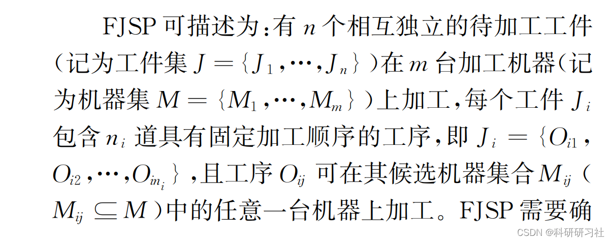
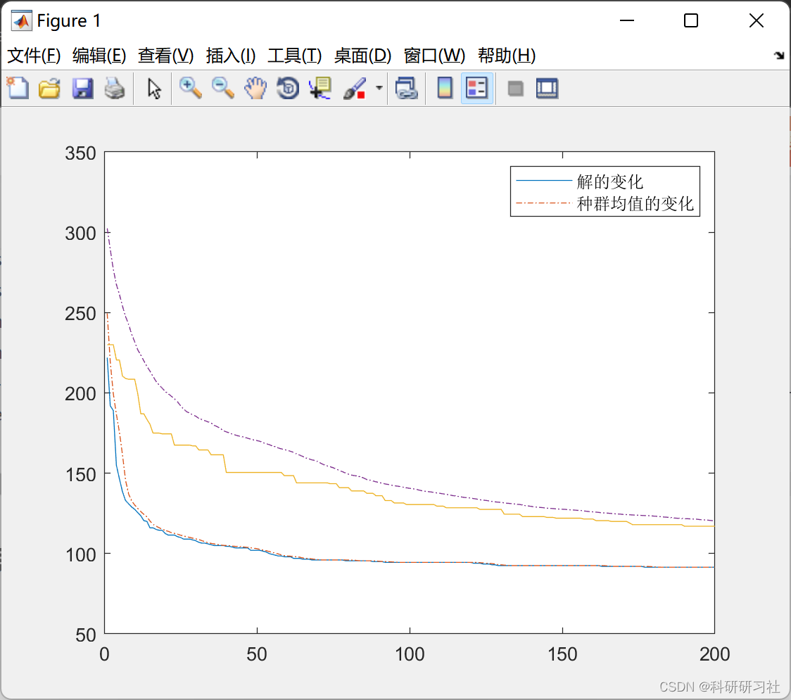
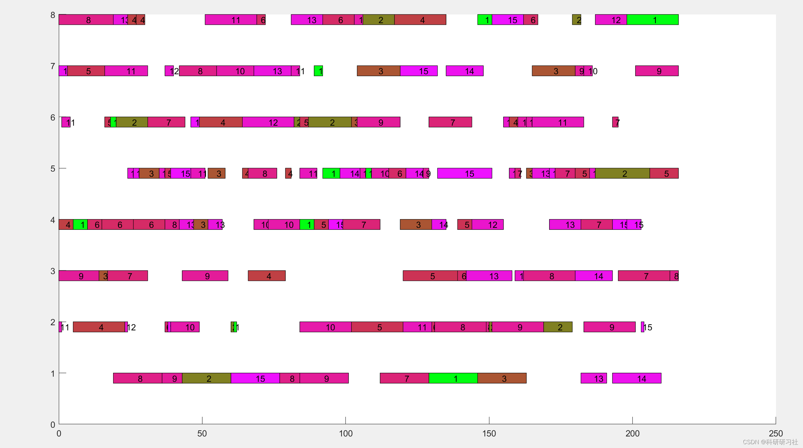
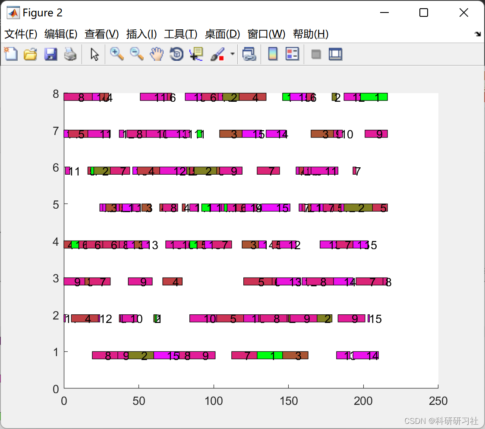

# Workshop Scheduling | Flexible Workshop Scheduling Based on Genetic Algorithm (Matlab Code Implementation)

1. Overview of Scheduling
Scheduling plays a crucial role in the production system by allocating production resources reasonably to shorten production time and improve resource utilization efficiency. The Job-shop Scheduling Problem (JSP) is a classic scheduling issue, aiming to optimize one or more scheduling indicators by arranging the processing order of n jobs on m machines. In JSP, each job consists of one or more operations with fixed processing sequences, and each operation is processed by a unique machine. The Flexible Job-shop Scheduling Problem (FJSP) is an extension of JSP, allowing multiple processing machines for one operation and potential differences in processing times on different machines, making it more general and reflective of flexible manufacturing systems. In FJSP, although machine flexibility can enhance the execution efficiency of the manufacturing system, it also expands the range of feasible solutions and increases the difficulty and complexity of solving the problem.
The Flexible Job-shop Scheduling (FJSP) is a type of scheduling problem with broad application backgrounds. As one of the most popular algorithms for solving FISP, genetic algorithms have attracted widespread attention. This paper comprehensively reviews the genetic algorithms for solving FJSP, especially five main chromosome encoding methods and their related crossover and mutation operators. It evaluates these five encoding methods from seven dimensions: coding feasibility, mapping relationship between coding space and solution space, chromosome storage space, decoding complexity, coding completeness, genetic operation complexity, and genetic operation diversity. The results show that the MSOS-I encoding method is a good chromosome encoding method for genetic algorithms solving FJSP, with simple chromosome structures and the ability to select a variety of crossover and mutation operators.
2. Genetic Optimization Algorithm
Intelligent optimization algorithm - Genetic Algorithm (Python & Matlab implementation)
Intelligent optimization algorithm - Genetic Algorithm
3. Shop Scheduling
1. Define the processing machines for each process (path subproblem), and determine the order of processing all processes on the machine (scheduling subproblem) to achieve optimization of one or more scheduling objectives, such as maximum completion time, total machine load, total delay time, maximum relaxation time, etc.
2. Solving FJSP typically requires satisfying the following assumption conditions:
(1) At the start of time, all workpieces are in the waiting state, and all machines are idle.
(2) At the same time, a single workpiece can only be processed by a single machine at a certain step.
(3) At the same time, a single workpiece can only be processed by one machine without interruption during the T-order.
(4) The processing order of a workpiece's steps is fixed and cannot be changed, and there is no sequence constraint between different workpieces' steps.
Based on the above description of FJSP, many scholars have proposed an O-l integer programming model to solve FJSP, and also the decomposition graph model is often used to describe FJSPL. This article will not provide the mathematical definitions of these models.
4. Matlab Code Implementation
This article only showcases part of the code, and the full code and article can be found in:
Genetic Algorithm-Based Flexible Workshop Scheduling (Matlab Code Implementation)
function [Z, machine_weight, pvals] = fitness(chroms, num_machine, e, num_job, num_op)
5. Running Results Editing
Editor
Editor
6. References [1] Huang Xuewen, Chen Shaofen, Zhou Tianyu, Sun Yuting. Review on Genetic Algorithm for Solving Flexible Job Shop Scheduling [J]. Computer Integrated Manufacturing Systems, 2022, 28(2): 536-551
​  

## Images

<!-- PAYMENT_BLOCK -->

## Get this dataset

- Payment link (Stripe): [Buy now](https://buy.stripe.com/3cs8yP7sY87d0vu9AB)
- Payment QR code: 

<!-- /PAYMENT_BLOCK -->
